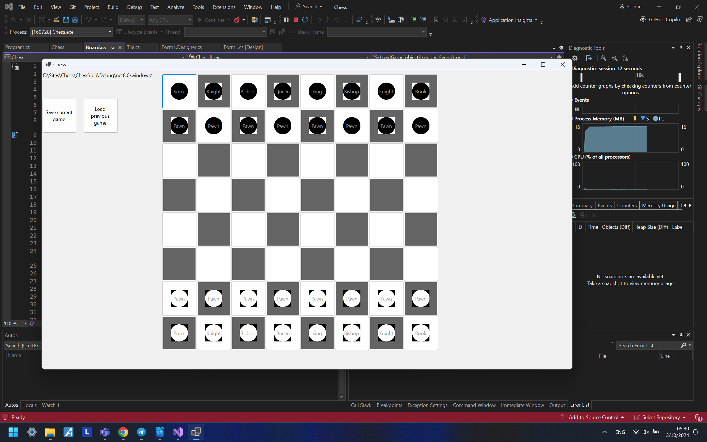
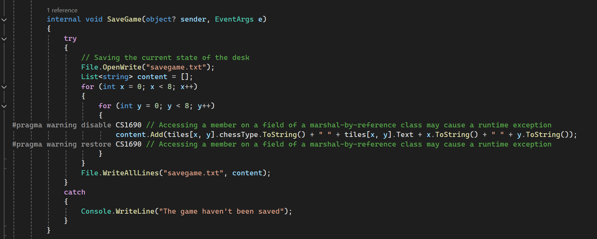
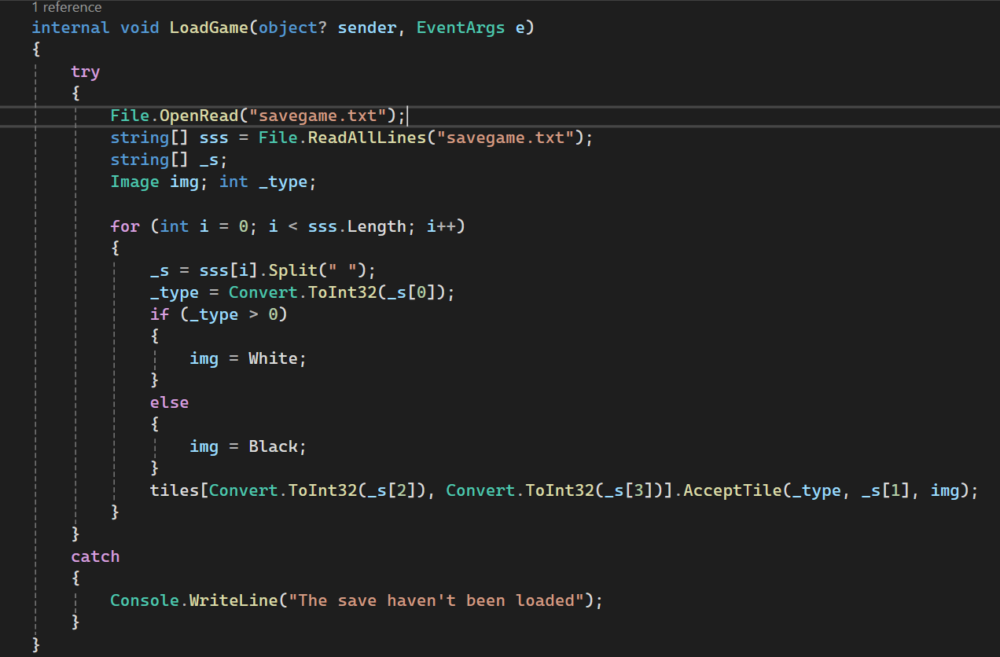
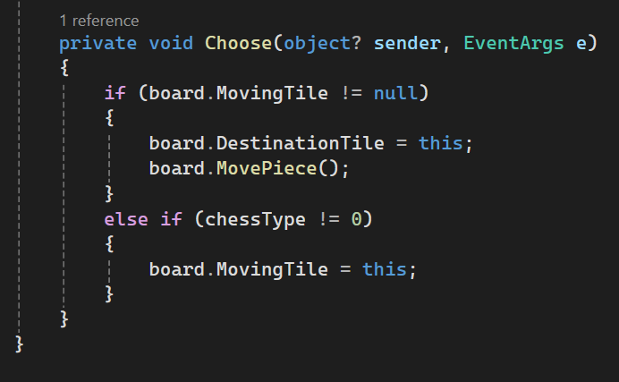
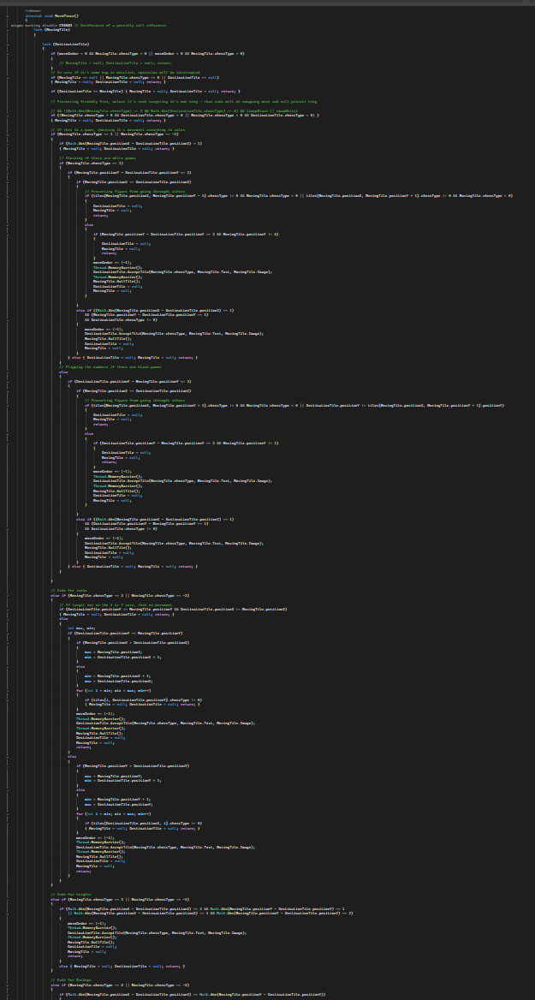

**1\. Design Thinking.**

Windows known for many things, and one of the most iconic of them is a game "Minesweeper". Games are a way to kill a time, take a break from boring routine and relax. Thus, a GUI app can help there. At this particular case I have chosen to make chess for 2 players on the same computer with ability to save and load state of board whenever players want even when internet isn't accessible.

**2\. Documentation**

**a)** This is a classic chess. This game has a tailed board, figures placed in right order, save/load buttons as well as display of the path to the current savefile.

Functionality of program: base game and ability to record current state of the board.

All pawns, rooks, knights, bishops, both King and Queen fully functional except the ability to do a "castling" or turn pawns into something once they'll reach the border of the board.

To chose where to attack, players firstly need to tap on the figure they want to use for attack, and then tap on the tail where they want to move figure or destroy the other one. In case if figure has been chosen by mistake, all players need to do is just to click on it again, and then they need to choose something else.

**b)** Event-driven code in my program:

1. Both "save" and "load" functions.

1. Trigger of figure's movement. Sends info about event to the bigger class that has more access to information and that determines figures' behaivour.

**c)** The main difference between primitive and the reference data types is that usually primitive types of data tends to be smaller, more disposable, and because of that instead of referencing them, program usually copies entire unit of data, which is why they usually also called "value types". Sometimes they re so small that references themselves can be bigger than amount of data that they store. There is such examples as: int (x8, x16, x32, x64 bit), float/double (sometimes decimal), string and many others. Some of them also can be seen on screenshots above. I also used such primitive data types as "Color" (struct), .

Reference classes, on the other hand, tends to be bigger to benefit from it the most, especially when there is necessity to keep data between several threads synchronized.
